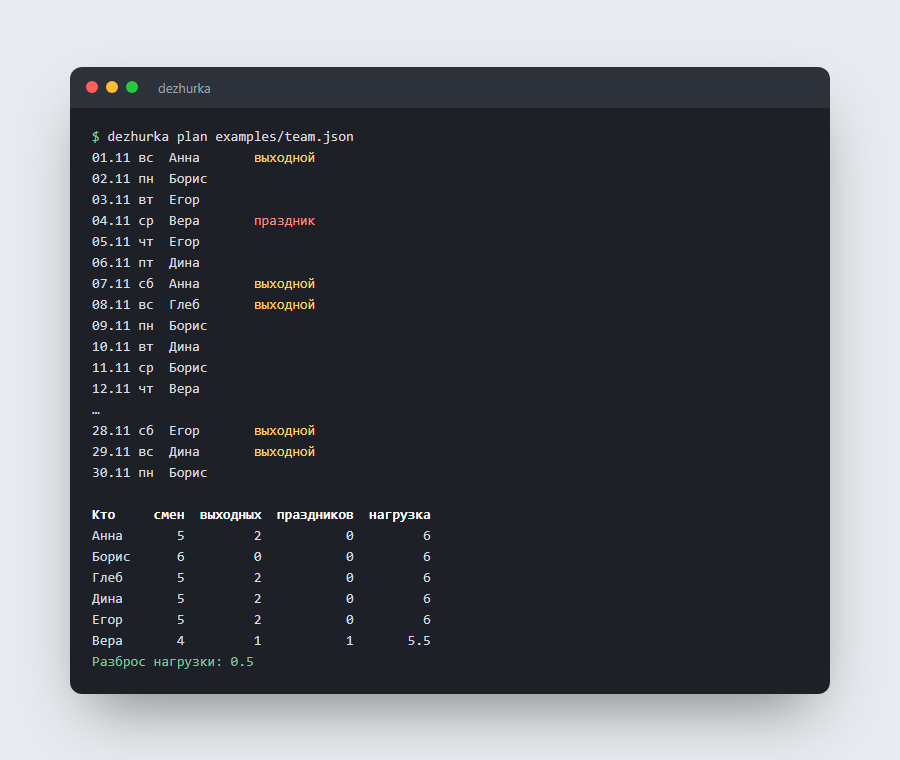

# dezhurka: честный график дежурств

Консольная утилита на C#, которая составляет график дежурств на месяц так, чтобы никому не было обидно. Выходные и праздники распределяются поровну, учитываются отпуска, дни, когда человек не может дежурить, отдых между сменами и лимит смен в неделю. Готовый график выгружается в календарь (.ics), CSV для таблиц и Markdown.




Это настоящий вывод на примере из [`examples/team.json`](examples/team.json). Борис не дежурит по выходным, у Анны неделя отпуска, у Веры не больше двух смен в неделю, и при этом нагрузка у всех 6 или 5,5, а выходные разошлись по 2.

## Как пользоваться

```bash
dezhurka example > team.json          # шаблон с комментариями
dezhurka check team.json              # проверить файл и посчитать, сколько смен на человека
dezhurka plan team.json               # график и итоги в консоли
dezhurka plan team.json -f csv -o november.csv
dezhurka plan team.json -f ics -o team.ics                 # общий календарь
dezhurka plan team.json -f ics --person Анна -o anna.ics   # только смены Анны
dezhurka plan team.json -f md                              # таблица для вики или задачи
```

Код выхода `1` значит, что какой-то день закрыть не удалось. Тогда для этого дня выводится, почему не подошёл каждый человек:

```
Не хватает 1 чел. на 10.11 вт:
  Анна: недоступен
  Борис: не дежурит по вт
```

## Файл команды

```jsonc
{
  "start": "2026-11-01",
  "end": "2026-11-30",
  "perDay": 1,              // сколько человек дежурит в день
  "minRestDays": 1,         // дней отдыха между сменами
  "maxPerWeek": 3,          // смен в неделю, можно переопределить у человека
  "weekendWeight": 1.5,     // выходной тяжелее будня
  "holidayWeight": 2,
  "holidays": ["2026-11-04"],
  "people": [
    { "name": "Анна", "unavailable": ["2026-11-09..2026-11-15"] },
    { "name": "Борис", "never": ["сб", "вс"] },
    { "name": "Вера", "maxPerWeek": 2 }
  ]
}
```

Даты и диапазоны включительно, дни недели по-русски (`пн`…`вс`) или по-английски (`mon`…`sun`), комментарии в JSON разрешены. Ошибки называют место: «Анна: в диапазоне "2026-11-09..2026-11-01" конец раньше начала», «Имя "Вера" встречается дважды».

## Как устроено

Составление графика — задача с ограничениями. Утилита решает её в два этапа.

1. **Жадно.** Дни идут по порядку, на каждый берутся доступные люди с наименьшей взвешенной нагрузкой (будний 1, выходной 1,5, праздник 2). При равенстве выбор решает перемешанный по зерну порядок, а не порядок в файле, чтобы первым в списке не доставалось больше.
2. **Локальный поиск.** Штраф — сумма разброса общей нагрузки и разброса числа тяжёлых смен. Перебираются два хода, и первый, который уменьшает штраф, принимается:
   - **передать** смену другому человеку;
   - **обменяться** сменами двоим, например выходным на будний: без этого хода общая нагрузка может быть ровной, а выходные — 3/3/1/1/1.

   Каждый ход проверяет все правила заново, поэтому улучшение никогда не нарушает ограничений.

Без второго этапа на примере выходные распределялись 3, 3, 1, 1, 1, а разброс нагрузки был 1. После него стало 2, 2, 2, 2, 1 и 0,5.

**Календарь** соответствует RFC 5545: события на весь день, переводы строк CRLF, экранирование, перенос строк длиннее 75 байт без разрыва UTF-8 символа. UID событий стабильный, поэтому при повторном импорте календарь обновит события, а не задвоит их.

```
src/Dezhurka/Config.cs      чтение и проверка team.json
src/Dezhurka/Scheduler.cs   жадное распределение, правила, локальный поиск, статистика
src/Dezhurka/Export.cs      консоль, CSV, iCalendar, Markdown
src/Dezhurka/Program.cs     команды plan, check, example
```

## Сборка

```bash
dotnet run --project src/Dezhurka -- plan examples/team.json
dotnet test
```

Готовые исполняемые файлы для Windows, Linux и macOS (без установленного .NET) собираются в CI и лежат в артефактах и [Releases](https://github.com/whysafe/dezhurka/releases).

## Тесты

28 тестов на xUnit:
- **Правила:** каждый день закрыт нужным числом разных людей, соблюдаются отпуска, дни недели, отдых между сменами и недельный лимит.
- **Справедливость:** разброс нагрузки, выходные поровну, и отдельно пример из README, где один человек не работает по выходным.
- **Невыполнимый день** сообщается с причиной для каждого.
- **Детерминизм по зерну.**
- **Разбор конфигурации:** восемь видов ошибок.
- **Экспорт:** формат iCalendar (CRLF, длина строк, экранирование, личный календарь, стабильные UID), экранирование CSV.
- **Сквозные сценарии CLI.**

## Автор

whysafe · [whysafe.ru](https://whysafe.ru) · Telegram [@yawhysafe](https://t.me/yawhysafe) · канал [@whysafe_official](https://t.me/whysafe_official) · [Kwork](https://kwork.ru/user/whysafe) · hello@whysafe.ru

## Лицензия

MIT
